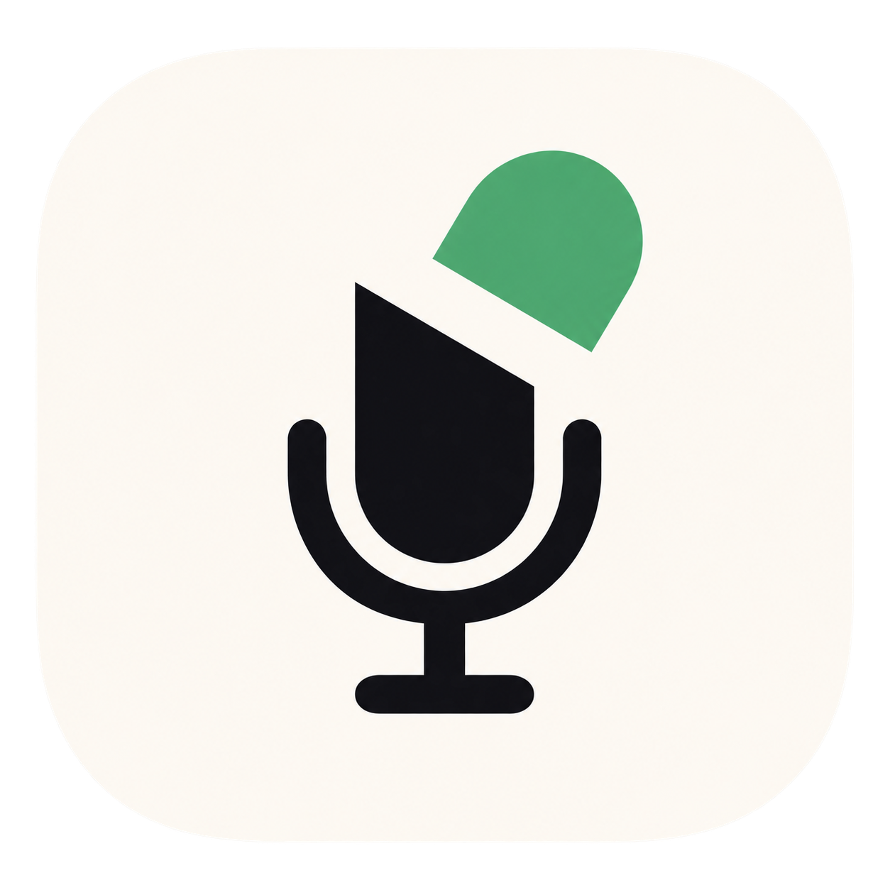
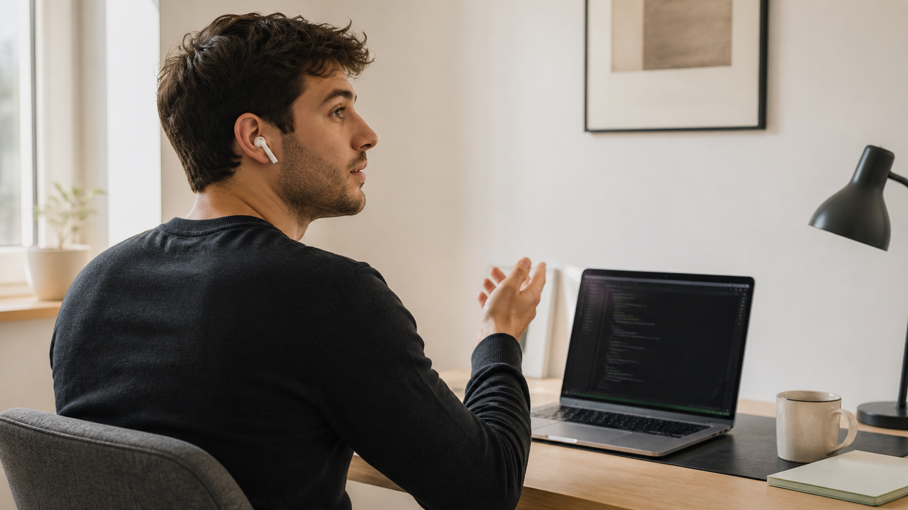
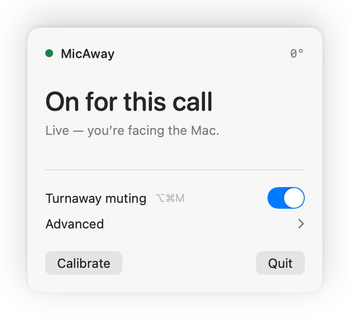
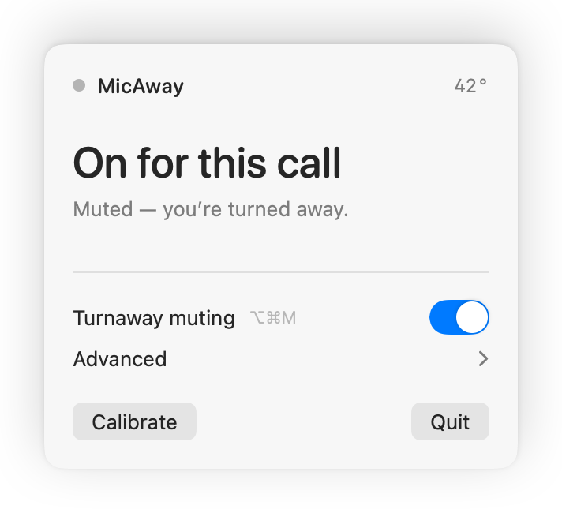

<p align="center">
  
</p>

<h1 align="center">MicAway</h1>

<p align="center"><strong>Turn to answer. The call mutes.</strong></p>

<p align="center">
  Face your Mac and the mic comes back. An aside to someone beside you never hits the meeting. AirPods motion, on this Mac. No account. No network. It never hears a word.
</p>

<p align="center">
  <a href="https://github.com/akashp1712/micaway/releases/latest"><strong>Get MicAway</strong></a>
  ·
  <a href="apps/mac/README.md">How it works</a>
  ·
  <a href="https://github.com/akashp1712/micaway/issues/new?template=compatibility-report.yml">Report compatibility</a>
</p>

<p align="center">
  
  
  
  <a href="LICENSE"></a>
</p>

<p align="center">
  
</p>

<p align="center">
  
  &nbsp;
  
</p>

> [!IMPORTANT]
> **Version 0.5.4 is a universal developer preview** (Apple silicon + Intel), ad-hoc signed but not yet Developer ID signed or notarized. It is free to download and audit, but macOS will ask you to approve the first launch. Notarized distribution can come later; the source and behavior are available now.

## How it works

Someone leans in mid-call. You turn to answer, and the meeting hears your aside.

MicAway turns where you face into the mute button:

1. Wear AirPods, face the Mac, and set forward once.
2. Join the call.
3. Turn toward someone and you are muted. Face the screen and you are live.

No push-to-talk. No wake word. No audio processing. ⌥⌘M pauses or resumes MicAway.

### What "muted" means

MicAway mutes the macOS **input device** through Core Audio. The room goes quiet: the call receives silence from your microphone.

MicAway does **not** press the call app's own mute button and does not send its shortcut. The mic icon inside Zoom, Teams, Slack, or Meet may stay open while nobody hears you. Some apps mirror the device mute into their icon and some do not. When you face the Mac again, MicAway unmutes only the inputs it muted. A mute you set yourself stays set.

Meet, Slack, and other apps may show a notice such as "Microphone muted by system" while you are turned away. That notice is expected; it clears when you face the Mac.

### When MicAway lets go

A stuck mute is worse than a missed one, so MicAway releases the mic whenever it cannot be sure you are turned away:

- **Only during a call.** It mutes only while an app is using the microphone. Turning away with nothing recording does nothing, so the next call never starts on an already-muted mic.
- **No motion, no mute.** If AirPods disconnect or head-motion samples stop for more than 1.5 seconds, the mic is restored. This happens when a call switches AirPods into headset mode. The menu says **Motion paused** until samples return. If you are still turned away when samples come back, the mic mutes again.
- **Devices that come back.** AirPods can drop and re-add their microphone when a call starts. MicAway tracks inputs by their stable device ID, finds the re-added microphone, and unmutes it. It checks that the unmute held, and retries if it did not.
- **After a crash.** MicAway saves the list of inputs it muted. If it quits unexpectedly, the next launch unmutes them.

## Supported calls

| App | How it is allowed |
| --- | --- |
| **Zoom** | Allowed apps, out of the box |
| **Microsoft Teams** | Allowed apps, out of the box |
| **Slack** huddles | Allowed apps, out of the box |
| **FaceTime** | Allowed apps, out of the box |
| **Google Meet in the browser** | Chrome, Safari, Arc, and Firefox are in Allowed apps, out of the box |
| Discord, Webex | Allowed apps, out of the box |

It also keeps an aside out of dictation apps such as Wispr Flow, FluidVoice, or ChatGPT Voice. Add them through **Allowed apps → Add _App Name_**. FluidVoice is manually verified; Wispr Flow and ChatGPT Voice need community testing.

If you test another Mac, AirPods model, or app, open a [compatibility report](https://github.com/akashp1712/micaway/issues/new?template=compatibility-report.yml). Never paste private dictated text into an issue.

## Compatibility

| What | Supported |
| --- | --- |
| **macOS** | 14 (Sonoma) or newer. `CMHeadphoneMotionManager` sets this floor. |
| **Mac chips** | Universal binary. Apple silicon — M1, M1 Pro/Max/Ultra, M2, M3, M4 (all variants) — natively, plus Intel Macs. |
| **AirPods (head tracking)** | AirPods Pro (1st & 2nd gen), AirPods (3rd & 4th gen), AirPods Max. Any AirPods with dynamic head tracking work; MicAway degrades gracefully on models without it. |
| **Without AirPods** | No head tracking. Use the voice app's normal mute control. |

Head-tracking availability can still vary by AirPods generation, connection
state, and macOS behavior. If a combination behaves differently, please file a
[compatibility report](https://github.com/akashp1712/micaway/issues/new?template=compatibility-report.yml).

## Install the preview

1. Download `MicAway-0.5.4-universal.zip` from the [latest release](https://github.com/akashp1712/micaway/releases/latest) and, optionally, verify it against `MicAway-0.5.4-universal.sha256` with `shasum -a 256 -c MicAway-0.5.4-universal.sha256`.
2. Unzip it and move `MicAway.app` to **Applications**.
3. Try to open MicAway. If macOS blocks it, open **System Settings → Privacy & Security**, scroll to **Security**, choose **Open Anyway**, and confirm **Open**.
4. If macOS still refuses to open the unsigned preview, run the following commands in Terminal:

   ```bash
   xattr -cr "/Applications/MicAway.app"
   open "/Applications/MicAway.app"
   ```

   > [!WARNING]
   > Run this only for `MicAway.app` downloaded from the [official GitHub release](https://github.com/akashp1712/micaway/releases/latest). It removes quarantine metadata from MicAway only. Never run it against your entire Applications or Downloads folder, and never replace the app path with a wildcard.

5. Put compatible AirPods in both ears, allow **Motion** access when macOS asks, face your Mac, and select **Calibrate**.

   Because the preview is ad-hoc signed, macOS ties Motion access to each exact build. After you install a new version, macOS may ask again, or may silently stop sending motion. If the menu says **No head motion**, open **System Settings → Privacy & Security → Motion & Fitness** and turn on MicAway.

Then tune it to how you work:

- **Turnaway muting** is the master switch (`⌥⌘M`). Switch it off while moving around; switching it back on re-centers to your current position before automatic muting resumes.
- **Advanced → Use in** defaults to **Selected apps**. **Allowed apps** starts with Zoom, Microsoft Teams, Slack, FaceTime, Discord, Webex, Google Chrome, Safari, Arc, and Firefox, so a call works on first launch. To add another app, such as a dictation app or a different browser, bring it forward, open MicAway, and choose **Allowed apps → Add _App Name_**. If an app that is not allowed is also using the microphone, automatic muting stays off.
- **Advanced → Never mute during** is for calls you want left alone. It starts empty. While an app on this list has the microphone, MicAway does not mute, in either Use in mode.
- **Advanced → Sensitivity** is a slider for how far you turn before the mic mutes (25–65°, default 45°). Drag toward High for a smaller turn; the readout shows the mute-past angle.

MicAway lives in the menu bar. It runs on macOS 14 or newer and is a universal binary — native on Apple silicon (M1–M4) and Intel Macs.

#### Upgrading from an earlier version

Earlier versions put Zoom, Microsoft Teams, Slack, FaceTime, Discord, and Webex on **Never mute during**, so MicAway stood down in those calls. On the first launch after upgrading, MicAway migrates once. If **Never mute during** still holds exactly those six apps and **Allowed apps** is empty, the six move into **Allowed apps** and **Never mute during** is cleared. If you edited either list, both stay as you left them. If you never chose a **Use in** mode, an upgraded install keeps **Every app**, which it was already using.

MicAway does **not** request Microphone or Accessibility access. It reads AirPods motion locally and changes writable input-device mute state through Core Audio; it does not listen to or control your Mac through Accessibility APIs.

Use the normal mute control in your voice or meeting app whenever you need a deliberate mute. MicAway restores only input devices it muted itself, so it does not undo a mute that was already active elsewhere.

## Privacy by construction

MicAway does not request microphone permission because it never listens to your microphone.

- no audio recording or transcription;
- no analytics or account;
- no network service;
- calibration stays on your Mac;
- the source is small enough to inspect.

It reads head direction from supported AirPods and changes the mute state of available input devices through macOS audio APIs.

## Build from source

Requirements: macOS 14+, Xcode Command Line Tools, and Swift 5.10 or newer.

```bash
git clone https://github.com/akashp1712/micaway.git
cd micaway/apps/mac
./scripts/build-app.sh      # universal arm64 + x86_64 .app in dist/
open "dist/MicAway.app"
```

Run the tests with:

```bash
cd apps/mac
./scripts/test.sh
```

`test.sh` runs the canonical swift-testing suite via SwiftPM when the toolchain is healthy, and otherwise falls back to a standalone `swiftc`-compiled runner that mirrors the same assertions — useful when a Command Line Tools install leaves `swift test` broken with `Invalid manifest … PackageDescription.Package.__allocating_init`.

Package the universal release archive and checksum with:

```bash
cd apps/mac
./scripts/package-release.sh 0.5.4
```

## Repository map

```text
apps/mac/   Swift menu-bar app, motion tracking, and tests
apps/web/   MicAway landing page
```

## Known limits

- Compatible AirPods and Motion access are required for head tracking.
- Each new ad-hoc signed build may need Motion access granted again. The menu shows **No head motion** until it is.
- The downloadable build is universal (Apple silicon + Intel) but ad-hoc signed, not Developer ID signed or notarized.
- A voice app using a non-mutable virtual microphone may need a future MicAway virtual-input mode.
- Selected Apps works at the macOS application level, not at the individual browser-tab level. Allowing a browser allows every tab in it.
- MicAway mutes the input device, not the call app's button. The in-app mic icon may stay open while the room hears silence.
- Headphone motion availability can vary by AirPods generation, connection state, and macOS behavior.

## Contributing

Bug reports, compatibility results, accessibility improvements, and focused pull requests are welcome. Start with [CONTRIBUTING.md](CONTRIBUTING.md), and read [SECURITY.md](SECURITY.md) before reporting a vulnerability.

## License

MicAway is available under the [MIT License](LICENSE). © 2026 Akash Panchal.

MicAway is an independent open-source project and is not affiliated with or endorsed by Zoom, Microsoft, Slack, Google, Wispr Flow, FluidVoice, OpenAI, or Apple. Product names and logos belong to their respective owners.
